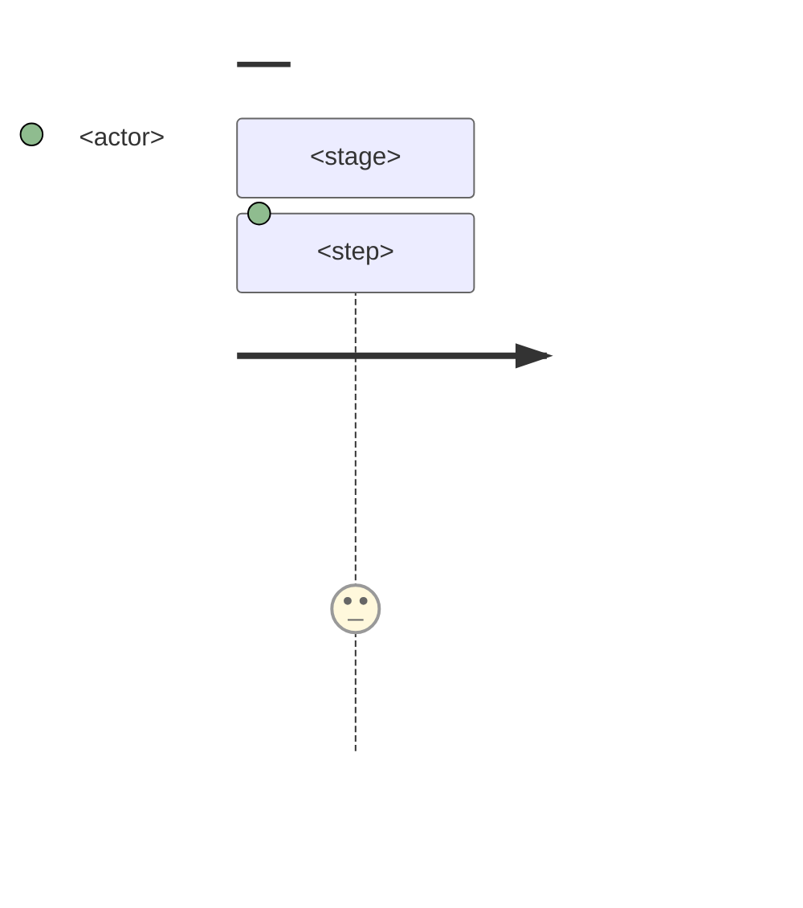
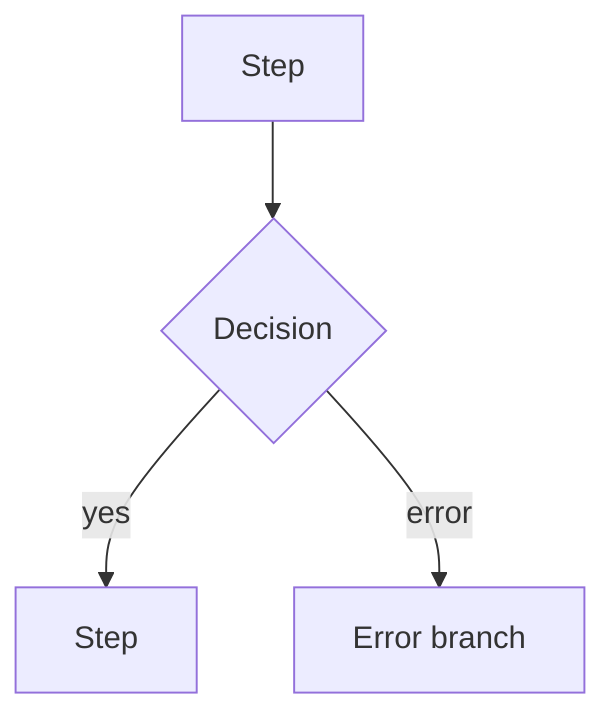

# UX-1 · Journeys and flows

> Status: DRAFT · Date: YYYY-MM-DD

## Journeys (one per user type)

## Flows
### FLOW-1 · <name>
- Stories: <US-N…>
- Start: <entry point / SCR-N> · End: <SCR-N, the state left behind>

| Step | Actor | Screen | Data read / written | Contract | Permission (who may; others see) | State after |
|---|---|---|---|---|---|---|
| 1 | | SCR-N | | CON-N (draft) or none | | |

- **States the user can see:** <empty · loading · partial · stale · done…>
- **Recovery paths:** <error branch → how the user gets back on track, and what is kept>

## Open behaviour questions (routed to UX-3a; Innocent decides)
> Anything the flows depend on that is not yet decided. Never resolve one silently in a flow.

| ID | Question | Affects (CON / FLOW / SCR) | Status |
|---|---|---|---|
| UXP-1 | | CON-N, FLOW-N | awaiting |
