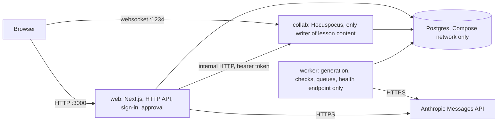

# Architecture — Newsela Lesson Studio

**Status:** draft (NL-04), written from the design outputs DO-1…DO-7 before any code exists. It is a reader's map: it
links to the documents that own each fact and does not copy them. Where a number comes from a design target it carries
`[T]` (target), `[A]` (assumption) or `[C]` (calculation) and a link; where it will come from a run it reads
`pending: NL-n`. NL-139 fills the measured numbers and the final limits. Contracts are never restated here
([`contracts/INTERFACE.md`](contracts/INTERFACE.md) owns them).

## 1. Why it exists

Newsela is entering California "Core" ELA/ELD instruction: whole-year programs, each unit a set of roughly forty
lessons. Its content creators have written lessons by hand, which the brief calls slow and hard to coordinate. The
brief states the stake in one line: "ARR (annual recurring revenue) - 10's of millions market for us"
([brief](source/01-project-brief.md)).

The north star is **reviewer minutes per approved lesson**: how long a trained person works on a generated lesson
before it is approved at the state's bar. It is never read without its guardrail G-2, the fast-approval rate, which
catches approvals bought by skimming ([metrics registry](design/metrics-registry.md), M-1 and M-3). The problem
behind the brief is that **review, not drafting, is the bottleneck**. The system exists to make each reviewer-minute
count: it drafts, checks in code, and leaves judgement and the final yes to a named person. The tool is expert-driven
by design ([framing](delivery/2026-10-24-angle-and-demo-framing.md)).

## 2. What it does, with one example

An author uploads the Grade 6 Unit 4 outline sheet. The steps, with the document that owns each:

1. **Outline row to run.** The web app normalizes the sheet in plain code (no model call) and stores an immutable
   outline version; the author presses Generate and a run with one job per lesson row is written
   ([architecture §4, F-1](design/architecture.md)).
2. **`UnitPlan`, then `LessonDraft`.** The worker makes one structured call for the plan, then one call per lesson,
   with at most one repair call when checks fail (hard problem HP-1, proven by spike SP-1,
   [spike record](analysis/spikes/SP-1-one-call-draft.md)).
3. **Compiled lesson and checks.** Code compiles the draft into the editor's document format and runs the check suite;
   nothing a model wrote is stored as a lesson until it passes those checks ([architecture §5](design/architecture.md)).
4. **Review.** Reviewers co-edit the lesson in the browser, resolve issues and confirm standards.
5. **Submit freeze.** Submitting locks the lesson and writes an immutable snapshot with its hash (HP-5, spike SP-2,
   [spike record](analysis/spikes/SP-2-freeze-at-submit.md)).
6. **Approve.** A second account approves the snapshot it was shown; if the pinned version is stale the approval is
   refused ([architecture §4, F-3](design/architecture.md)).
7. **Export.** Only approved snapshots are exported.

Every place a model decides control flow, its rung (single structured call, no agent loop) and the code that decides instead
are listed in [architecture §5](design/architecture.md); each design choice's cost is stated in the card or section that owns it.

Input, process, output: outline row 8 in, one `LessonDraft` out, compiled and checked, reviewed by one person,
frozen at Submit, approved by another on the pinned version, exported as an approved snapshot.

## 3. Processes and data

Three Node processes share one code base and one Postgres database, run locally under Docker Compose (PD-15 option D:
local Compose, the `render.yaml` is committed but nothing is provisioned on Render). Component duties, trust
boundaries and record ownership are in [`design/architecture.md`](design/architecture.md) (DO-2); the sizing and
decision sentences are in [`design/system-design.md`](design/system-design.md) (DO-1).

The processes meet only in Postgres: the worker is woken by `lesson_job` and `check_job` rows, never called directly.
Ports are the design defaults in [`design/code-design.md`](design/code-design.md) §7 (web 3000, collab 1234); Postgres
is not published on a host port (trust boundary TB-6 in DO-2).

## 4. Code layout

The code is one npm-workspaces repository in TypeScript, cut into build areas A0–A21 and a foundation wave. The
area table (which files each owns, what each calls in earlier waves) is DO-3 [§4](design/code-design.md); the
machine-readable map for agents is [`.claude/reference/area-map.md`](../.claude/reference/area-map.md); the repository
layout and modules are DO-3 §1–§2.

Ports and adapters: every outside dependency (database, model provider, Google Sheets, collaboration server) sits
behind an interface in `packages/core/src/ports`, with one real adapter and one test double, so services are unit
tested with fakes (DO-3 [§3](design/code-design.md)). Dependencies point inward and a lint rule enforces the
boundary. Table ownership: DO-3 §6. Typed settings: DO-3 §7.

| Areas | Concern | Where defined |
|---|---|---|
| A0–A2 | platform, storage and DDL, shared schemas | DO-3 §4 |
| A3–A8 | auth, intake, compile, checks, model client, spend | DO-3 §4 |
| A9–A13 | generation, runs, collaboration, review, metrics | DO-3 §4 |
| A14 | web UI per screen | DO-3 §4, [`ux/03-structure/SCREEN_SPECS.md`](ux/03-structure/SCREEN_SPECS.md) |
| A15–A19 | assist, prompts, export, coverage, judge (cuttable, PD-17) | DO-3 §4 |
| A20–A21 | evals and load scripts, operations | DO-3 §4 |

## 5. Contracts

All 24 agreed interface cards (CON-1…CON-24) live in [`contracts/INTERFACE.md`](contracts/INTERFACE.md), with the
machine-readable [OpenAPI file](contracts/interface.openapi.yaml) (served as a mock by Prism for frontend work) and
generated types in `contracts/generated/`. Any change to an agreed card goes through
[`contracts/CHANGES.md`](contracts/CHANGES.md) as a numbered change. Component signatures that serve the cards are DO-4
([`design/component-contracts.md`](design/component-contracts.md)). Nothing about request or response shape is repeated
in this document.

## 6. Hard problems and how each was settled

Each card, its options and its evidence are in [`design/hard-problems.md`](design/hard-problems.md).

| Card | Settled as | Spike result |
|---|---|---|
| HP-1 pipeline shape | fixed skeleton, one structured call per lesson, compiled by code | SP-1: 3 of 3 drafts valid, no truncations, 47-entry plan; the schema travels in the prompt and Zod validates in code ([SP-1](analysis/spikes/SP-1-one-call-draft.md)) |
| HP-2 grounding without source texts | no quote block in the draft; only a person inserts quotes; three code scans | SP-3: 11 of 11 detectable plants caught; the name scan blocks only in check items ([SP-3](analysis/spikes/SP-3-invention-scans.md)) |
| HP-3 proving alignment | every code carries its origin; narrowed and added codes need a named confirmer | none needed |
| HP-4 canonical copy | the live document is the master; derived JSON, hash and state vector written in one transaction | shares SP-2 |
| HP-5 approval integrity | Submit freezes; approval pins hash and state vector; stale pins are refused | SP-2: 20 of 20 on every assertion; store transaction p95 measured on an in-process database, so re-measured on Postgres ([SP-2](analysis/spikes/SP-2-freeze-at-submit.md)) |
| HP-6 outline normalization | plain code, no model call; only errors block Generate | none needed |
| HP-7 long jobs | one job table as queue and progress, checkpointed raw output, reserve-then-settle spend | SP-1 sets the caps (6 jobs in flight, a per-run spend cap, both `[C]` in HP-7) |
| HP-8 measuring the north star | heartbeats with honesty rules, human sessions only, first approval | none needed |
| HP-9 content-safety notes | rules propose, the author confirms, code places a teacher-only note | none needed |
| HP-10 quality of the teaching | the reviewer is the quality gate, with a one-click draft rating at approval | none needed |

## 7. Evaluation, observability, metrics

- **Evaluation** ([`design/eval-plan.md`](design/eval-plan.md), DO-5): fourteen suites S1–S14, from the intake golden
  suite (S1) to the capacity spike (S14), each with its grader, case provenance and held-out separation. Results:
  full run and draft golden pending: NL-112; metrics scoring and reruns pending: NL-134; capacity spike pending: NL-127.
- **Observability** ([`design/observability.md`](design/observability.md), DO-6): every entry point that does work has a
  stable workflow id (WF-n), a correlation key, required records and a **capture check** that proves the records are
  written when the real entry point is driven. A workflow is not done until its capture check passes.
- **Metrics** ([`design/metrics-registry.md`](design/metrics-registry.md), DO-7): the registry M-1 onward, each with
  definition, source records, owner, action and target. Measured values: pending: NL-134 (outcome metrics) and
  pending: NL-127 (performance metrics).

## 8. Capacity

The decision is Innocent's (PD-33): 500 users a day with a 200-user concurrent spike. Generation load is a separate
quantity, limited by the provider and spend caps and not by user count. Workload mix, burst shape and the performance
targets `[T]` are in [`design/capacity-and-workload.md`](design/capacity-and-workload.md). Measured results against the
targets: pending: NL-127.

## 9. Data handling and safety

- **GR-9:** crawled Newsela content stays in a git-ignored folder, is never committed, mounted into a container or
  used in a prompt, and the repository stays private ([PRD](prd/newsela-prd.md), guardrail table).
- **GR-13:** no student or teacher-of-record data; staff authentication only. Test and demo data is synthetic and
  seeded.
- **Keys:** provider keys are loaded only by the workspace launcher at start-up and never stored in a project file or
  image (trust boundary TB-3, [DO-2](design/architecture.md)).
- **Audit:** the audit log is append-only; updates and deletes are rejected at the database (DO-2 data authority).
- Review activity is reported in aggregate only and never by named person (GR-15).

## 10. Limits

This section follows GR-14 (demo honesty) and is a draft until NL-139.

- Nothing is built yet; every behaviour above is a design, and spike results come from throwaway code.
- Spike numbers were taken on a few drafts; the full-unit run is pending: NL-112.
- The north star will be measured on one reviewer (Innocent), so it is labelled as such with its sample size and is
  not a population estimate; pending: NL-134.
- Capacity is validated by a load script with the model provider stubbed; pending: NL-127. The collaboration
  load script is a cuttable item (PD-17); if cut, collaboration latency under load was not measured.
- Judge, AI assist, prompt saving, export, coverage matrix and the quality page are cuttable (PD-17); final status is
  recorded by NL-139.
- Hosting is local Docker Compose; the Render configuration is committed but not provisioned (PD-15 option D).
