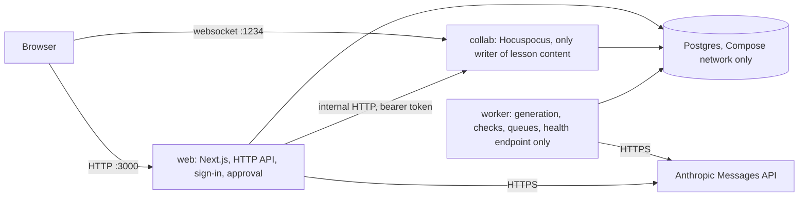

# Architecture — Newsela Lesson Studio

**Status:** NL-139 pass of 2026-10-26. Written from the design outputs DO-1…DO-7 (NL-04); the capacity numbers are now
filled from the NL-127 report. It is a reader's map: it links to the documents that own each fact and does not copy
them. Where a number comes from a design target it carries `[T]` (target), `[A]` (assumption), `[C]` (calculation) or
`[M]` (measured, with *n* and a report path). Two things are still unmeasured and keep their marker, `pending: NL-112`
(the real-model full run) and `pending: NL-134` (experiment scoring); both need Innocent's yes to spend, and no result
is claimed for them. Section 10 says what that means. Contracts are never restated here
([`contracts/INTERFACE.md`](contracts/INTERFACE.md) owns them).

## 1. Why it exists

Newsela is entering California "Core" ELA/ELD instruction: whole-year programs, each unit a set of roughly forty
lessons. Its content creators have written lessons by hand, which the brief calls slow and hard to coordinate. The
brief states the stake in one line: "ARR (annual recurring revenue) - 10's of millions market for us"
([brief](source/01-project-brief.md)).

The north star is **reviewer minutes per approved lesson**: how long a trained person works on a generated lesson
before it is approved at the state's bar. It is never read without its guardrail G-2, the fast-approval rate, which
catches approvals bought by skimming ([metrics registry](design/metrics-registry.md), M-1 and M-3). The problem
behind the brief is that **review, not drafting, is the bottleneck**. The system exists to make each reviewer-minute
count: it drafts, checks in code, and leaves judgement and the final yes to a named person. The tool is expert-driven
by design ([framing](delivery/2026-10-24-angle-and-demo-framing.md)).

## 2. What it does, with one example

An author uploads the Grade 6 Unit 4 outline sheet. The steps, with the document that owns each:

1. **Outline row to run.** The web app normalizes the sheet in plain code (no model call) and stores an immutable
   outline version; the author presses Generate and a run with one job per lesson row is written
   ([architecture §4, F-1](design/architecture.md)).
2. **`UnitPlan`, then `LessonDraft`.** The worker makes one structured call for the plan, then one call per lesson,
   with at most one repair call when checks fail (hard problem HP-1, proven by spike SP-1,
   [spike record](analysis/spikes/SP-1-one-call-draft.md)).
3. **Compiled lesson and checks.** Code compiles the draft into the editor's document format and runs the check suite;
   nothing a model wrote is stored as a lesson until it passes those checks ([architecture §5](design/architecture.md)).
4. **Review.** Reviewers co-edit the lesson in the browser, resolve issues and confirm standards.
5. **Submit freeze.** Submitting locks the lesson and writes an immutable snapshot with its hash (HP-5, spike SP-2,
   [spike record](analysis/spikes/SP-2-freeze-at-submit.md)).
6. **Approve.** A second account approves the snapshot it was shown; if the pinned version is stale the approval is
   refused ([architecture §4, F-3](design/architecture.md)).
7. **Export.** Only approved snapshots are exported.

Every place a model decides control flow, its rung (single structured call, no agent loop) and the code that decides instead
are listed in [architecture §5](design/architecture.md); each design choice's cost is stated in the card or section that owns it.

Input, process, output: outline row 8 in, one `LessonDraft` out, compiled and checked, reviewed by one person,
frozen at Submit, approved by another on the pinned version, exported as an approved snapshot.

## 3. Processes and data

Three Node processes share one code base and one Postgres database, run locally under Docker Compose (PD-15 option D: local Compose
at $0). Hosting on Render from the GitHub mirror was decided later (PD-37, 2026-10-26) and its setup is written in
[`delivery/render-deploy-prompt.md`](delivery/render-deploy-prompt.md); this document does not claim it is live (see
section 10). Component duties, trust
boundaries and record ownership are in [`design/architecture.md`](design/architecture.md) (DO-2); the sizing and
decision sentences are in [`design/system-design.md`](design/system-design.md) (DO-1).

The processes meet only in Postgres: the worker is woken by `lesson_job` and `check_job` rows, never called directly.
Ports are the design defaults in [`design/code-design.md`](design/code-design.md) §7 (web 3000, collab 1234); Postgres
is not published on a host port (trust boundary TB-6 in DO-2).

## 4. Code layout

The code is one npm-workspaces repository in TypeScript, cut into build areas A0–A21 and a foundation wave. The
area table (which files each owns, what each calls in earlier waves) is DO-3 [§4](design/code-design.md); the
machine-readable map for agents is [`.claude/reference/area-map.md`](../.claude/reference/area-map.md); the repository
layout and modules are DO-3 §1–§2.

Ports and adapters: every outside dependency (database, model provider, Google Sheets, collaboration server) sits
behind an interface in `packages/core/src/ports`, with one real adapter and one test double, so services are unit
tested with fakes (DO-3 [§3](design/code-design.md)). Dependencies point inward and a lint rule enforces the
boundary. Table ownership: DO-3 §6. Typed settings: DO-3 §7.

| Areas | Concern | Where defined |
|---|---|---|
| A0–A2 | platform, storage and DDL, shared schemas | DO-3 §4 |
| A3–A8 | auth, intake, compile, checks, model client, spend | DO-3 §4 |
| A9–A13 | generation, runs, collaboration, review, metrics | DO-3 §4 |
| A14 | web UI per screen | DO-3 §4, [`ux/03-structure/SCREEN_SPECS.md`](ux/03-structure/SCREEN_SPECS.md) |
| A15–A19 | assist, prompts, export, coverage, judge (cuttable, PD-17) | DO-3 §4 |
| A20–A21 | evals and load scripts, operations | DO-3 §4 |

## 5. Contracts

All 24 agreed interface cards (CON-1…CON-24) live in [`contracts/INTERFACE.md`](contracts/INTERFACE.md), with the
machine-readable [OpenAPI file](contracts/interface.openapi.yaml) (served as a mock by Prism for frontend work) and
generated types in `contracts/generated/`. Any change to an agreed card goes through
[`contracts/CHANGES.md`](contracts/CHANGES.md) as a numbered change. Component signatures that serve the cards are DO-4
([`design/component-contracts.md`](design/component-contracts.md)). Nothing about request or response shape is repeated
in this document.

## 6. Hard problems and how each was settled

Each card, its options and its evidence are in [`design/hard-problems.md`](design/hard-problems.md).

| Card | Settled as | Spike result |
|---|---|---|
| HP-1 pipeline shape | fixed skeleton, one structured call per lesson, compiled by code | SP-1: 3 of 3 drafts valid, no truncations, 47-entry plan; the schema travels in the prompt and Zod validates in code ([SP-1](analysis/spikes/SP-1-one-call-draft.md)) |
| HP-2 grounding without source texts | no quote block in the draft; only a person inserts quotes; three code scans | SP-3: 11 of 11 detectable plants caught; the name scan blocks only in check items ([SP-3](analysis/spikes/SP-3-invention-scans.md)) |
| HP-3 proving alignment | every code carries its origin; narrowed and added codes need a named confirmer | none needed |
| HP-4 canonical copy | the live document is the master; derived JSON, hash and state vector written in one transaction | shares SP-2 |
| HP-5 approval integrity | Submit freezes; approval pins hash and state vector; stale pins are refused | SP-2: 20 of 20 on every assertion; store transaction p95 measured on an in-process database, so re-measured on Postgres ([SP-2](analysis/spikes/SP-2-freeze-at-submit.md)) |
| HP-6 outline normalization | plain code, no model call; only errors block Generate | none needed |
| HP-7 long jobs | one job table as queue and progress, checkpointed raw output, reserve-then-settle spend | SP-1 sets the caps (6 jobs in flight, a per-run spend cap, both `[C]` in HP-7) |
| HP-8 measuring the north star | heartbeats with honesty rules, human sessions only, first approval | none needed |
| HP-9 content-safety notes | rules propose, the author confirms, code places a teacher-only note | none needed |
| HP-10 quality of the teaching | the reviewer is the quality gate, with a one-click draft rating at approval | none needed |

## 7. Evaluation, observability, metrics

- **Evaluation** ([`design/eval-plan.md`](design/eval-plan.md), DO-5): fourteen suites S1–S14, from the intake golden
  suite (S1) to the capacity spike (S14), each with its grader, case provenance and held-out separation. Results:
  full run and draft golden pending: NL-112; metrics scoring and reruns pending: NL-134. The capacity spike (S14) ran:
  see section 8. The stub-provider fault suite S6 passed 4 of 4 (`evals/reports/faults-05b70004372e.md`, n = 4, stub,
  cost $0).
- **Observability** ([`design/observability.md`](design/observability.md), DO-6): every entry point that does work has a
  stable workflow id (WF-n), a correlation key, required records and a **capture check** that proves the records are
  written when the real entry point is driven. A workflow is not done until its capture check passes.
- **Metrics** ([`design/metrics-registry.md`](design/metrics-registry.md), DO-7): the registry M-1 onward, each with
  definition, source records, owner, action and target. Measured values: outcome metrics pending: NL-134
  (no review sessions have been measured). Performance metrics M-18…M-27 are in section 8 [M], from
  [`evals/reports/load-2026-10-26.md`](../evals/reports/load-2026-10-26.md).

## 8. Capacity

The decision is Innocent's (PD-33): 500 users a day with a 200-user concurrent spike. Generation load is a separate
quantity, limited by the provider and spend caps and not by user count. Workload mix, burst shape and the performance
targets `[T]` are in [`design/capacity-and-workload.md`](design/capacity-and-workload.md). Measured results against the
targets are below. Full detail, qualifiers and the run command are in
[`delivery/capacity-report.md`](delivery/capacity-report.md); the raw report is
[`evals/reports/load-2026-10-26.md`](../evals/reports/load-2026-10-26.md).

**What was run [M]:** 200 virtual HTTP users plus 140 Yjs socket editors, 2 min ramp, 15 min plateau, 2 min ramp down,
on the VPS (8 cores, 31 GB), the committed Compose stack, **model provider stubbed**. Probe rows
`pr_01M5VD8MK0FYZW3E26YSKVTP4E` (http) and `pr_01M5VE7XWE796CFYZ7S22YE9GF` (yjs).

| Metric | Target `[T]` | Measured `[M]` (n) | Result |
|---|---|---|---|
| Lesson open p95 | < 1.5 s | 23 ms (n = 4,902) | met |
| Unit board p95 | < 1 s | 20 ms (n = 20,402) | met |
| Board poll p95 | < 300 ms | 20 ms (n = 20,402; the progress poll was not exercised) | met on the board only |
| HTTP error rate | < 0.5% | 0.00% of 38,909; 0 socket errors in 22,533 samples | met |
| Recovery after the plateau | <= 120 s | 100 s (computed over windows that overlap the ramp down) | met, weakly |
| Remote-edit p95 | < 500 ms | 6.7 ms (n = 44,612) | met |
| Lost acknowledged updates | 0 | 0 (n = 22,533) | met |
| Reconnect p95 | <= 10 s | 9.95 s | met by 0.05 s |
| **Stored p95** | **< 3 s** | **6,008 ms (n = 22,533)** | **MISSED** |

**The stored-latency target was missed and stays missed.** It was not tuned. The share of the 6,008 ms that is the
collaboration server's store debounce (2.0 s, with a 4.0 s ceiling) rather than the database write is **unproven
`[A]`**: the run did not log them separately. The follow-up analysis
([devlog](../docs/devlog/2026-10-26-nl127-followup.md)) reasons that the shipped ceiling alone puts p95 near 3.8 s plus
store time, with the remainder unmeasured; that is analysis, not a measurement. The report's label "M-24" for this figure
is wrong (M-24 is reconnect time); the stored figure belongs to US-36 / M-19. The scale path in
[`design/capacity-and-workload.md`](design/capacity-and-workload.md) has no step keyed to store latency, so no scale
step was taken; the next step is to separate the debounce wait from the write in the logs and re-run on a quiet
machine. Whether to lower the debounce, relax the target or accept the miss is Innocent's open decision.

**Qualifiers that make the passes weaker than they look:** a padded synthetic 40-lesson unit and small fixtures (not
real generated content; the real-key full run, NL-112, has not run); no generation load ran (the stub run's first job
failed, so the worker was idle); another agent used the machine during the run; a single VPS instance, not Render
(Starter sizes are 0.5 CPU / 512 MB, so these figures do not transfer).

## 9. Data handling and safety

- **GR-9:** crawled Newsela content stays in a git-ignored folder, is never committed, mounted into a container or
  used in a prompt, and the repository stays private ([PRD](prd/newsela-prd.md), guardrail table).
- **GR-13:** no student or teacher-of-record data; staff authentication only. Test and demo data is synthetic and
  seeded.
- **Keys:** provider keys are loaded only by the workspace launcher at start-up and never stored in a project file or
  image (trust boundary TB-3, [DO-2](design/architecture.md)).
- **Audit:** the audit log is append-only; updates and deletes are rejected at the database (DO-2 data authority).
- Review activity is reported in aggregate only and never by named person (GR-15).

## 10. Limits

This section follows GR-14 (demo honesty). Status at 2026-10-26; an item is **built**, **built, not run on real
data** or **cut**, and the cut or unbuilt ones carry PRD §6.4's "what we say instead".

**Not measured, and why**

- **Real-model full run (NL-112) has not run; `pending: NL-112`.** It spends model budget (PD-29, $75 ceiling) and needs
  Innocent's yes. Until then, no number here comes from a generated 47-lesson unit. The spike figures in section 6 come
  from throwaway code on a few drafts (SP-1: 3 of 3 drafts valid), not a population estimate.
- **Experiments and the north star (NL-134) are unscored; `pending: NL-134`.** No error-analysis round (NL-120), no `FT-N`
  failure types and no experiment has been run, so none is claimed. No review session has been measured. When it is, the
  north star is **one reviewer (Innocent), n = k sessions**, with k stated beside it, and is not a population estimate
  or a measure of Newsela's own staff (PRD §6.6: "No baseline (AQ-14); our reviewers").
- **Capacity** is measured with the model provider stubbed, on synthetic content, on a shared VPS (section 8). The stored
  p95 target (< 3 s) was **missed** (6,008 ms, n = 22,533); what that means: the demo stack does not meet its own
  store-latency target at 200 editors, and the scale path has no step for it yet.

**Built or cut (PRD §6.4 order)**

| Cut | Item | State | What we say |
|---|---|---|---|
| #1 | Yjs load script (R-56) | **Built and run once** (NL-119, 140 editors, section 8); the stored target was missed | as section 8 |
| #2 | Alignment judge (R-23) and held-out comparison (R-53) | **Code built** (judge worker NL-110, calibration script NL-111, held-out script NL-121); **not run on real labels or the real model**: Innocent's ~30 labels (NL-122) and the calibration record (NL-132) do not exist | "Alignment is checked by code and confirmed by a named reviewer; no calibrated model judge in this build"; any judge verdict is advisory and provisional, not expert |
| #3 | Arc checks (R-9) | **Cut**: no arc-check code found in the checks | "Arc coherence comes from the unit plan; cross-lesson checks are next" |
| #4 | Coverage matrix (R-41) | **Built** (NL-91 query, NL-73 screen, NL-117 end to end) | none needed; its data comes from stored alignment links |
| #5 | JSON export (R-42) | **Built** (NL-51, NL-75, NL-102); "Export (no live integration)" | the export file is not a live publish to Newsela |
| #6 | Unit quality page (R-50), seeded errors (R-52) | Page **built** (NL-74); the planting and report **tool built** (NL-92), but no errors were planted or reviewed (NL-124, NL-135) | "G-3 (seeded-error catch rate) not measured in this build" |
| #7 | Prompt-guidance editing (R-39) | Screen **built** (NL-76); prompts are versioned and pinned per run | not exercised against a real run |
| #8 | AI assist (R-31) | **Built** (NL-50, NL-72, NL-116); only the stub provider has been used | not run on the real model |

"Built" means merged with its tests. It is not "used in the demo on the real model": the connected-app walk (NL-126)
ran on the stub stack and marks real-model journeys NOT WALKED.

**Hosting**

- The demo ran under local Docker Compose (PD-15 option D, $0). Innocent then decided to host on Render from the GitHub
  mirror (PD-37, 2026-10-26); the setup steps are written in
  [`delivery/render-deploy-prompt.md`](delivery/render-deploy-prompt.md) and the Render service is **not claimed to be
  live here**: no verification of a live URL is on record in this repository. The Render configuration uses one owner
  database role (accepted risk AR-1), so append-only audit tables rest on database triggers, not on grants, there.
- The VPS is the build and rehearsal machine. **It is not production hosting.**

**Other limits**

- All data is synthetic (GR-13). The collab and judge paths, and the collaboration-under-load figures, are as stated above.
- Bounded code claims: the design sections of this document describe the design; where a claim was checked against code
  it is cited with its path in the owning design document, and this pass did not re-verify the design sections line by line.
