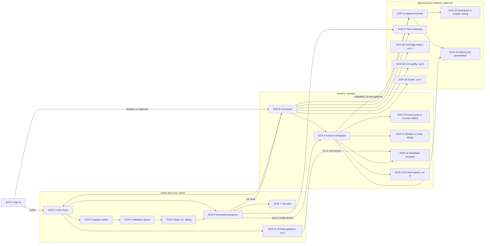

# UX-1 · Sitemap — Newsela Lesson Studio

> **Status:** DRAFT · **Date:** 2026-10-25 · **PRD** [v1.0](../../prd/newsela-prd.md).
> Flows: [`USER_FLOWS.md`](USER_FLOWS.md) · Stories: [`USER_STORIES.md`](USER_STORIES.md).

**What this is.** Every screen the product has, where you enter it, and how you reach it. A screen marked *dialog* or
*panel* opens over another screen; it is listed on its own because it has its own states, its own contract and its own
mockup at UX-2. A screen marked *cut #n* goes when that cut in the PRD's cut order fires (PRD §6.4).

**Three surfaces behind one sign-in** (R-54; staff only, GR-13):

1. **Intake and runs** (the author's side): units home, upload, the validation report, start run, the progress board,
   the unit plan, prompt guidance.
2. **Review** (the reviewer's side): the unit board, the lesson workspace with its evidence pane, and the dialogs and
   panels that open from it.
3. **Approval and evidence** (the approver's side): approval review, history, run summary, coverage, unit quality, export.

**Desktop first.** Reviewers edit ~3,300-word teacher editions beside an evidence pane, so the workspace is built for a
laptop (about 1280 px). Every screen still reads at phone width; editing on a phone is not a goal (proposal, settles at UX-3).

**Entry points.** Sign-in (SCR-1) is the only way in. After it, an author lands on the Units home (SCR-2) and a reviewer
or approver lands on the Unit board (SCR-8) (FLOW-1). Deep links to a lesson (SCR-9 or SCR-14) and to a run (SCR-6) open
after sign-in.

## Screens

| Screen | Name | Surface · kind | Main user | Reached from | Flows | Contracts | Cut | What it holds |
|---|---|---|---|---|---|---|---|---|
| SCR-1 | Sign in | all · page | P-1, P-2, P-3 | the app URL; any deep link when signed out | FLOW-1 | CON-1 | core | Staff email sign-in; "this email is not on the staff list"; the three demo accounts (one per role) |
| SCR-2 | Units home | intake · page | P-2 (all can open) | SCR-1 (author); the header link from SCR-8 | FLOW-1, FLOW-2 | CON-2, CON-6 | core | The unit card "Grade 6 · Unit 4"; outline versions with hash and date; the latest run's state; Upload outline; Prompt guidance (UXP-9) |
| SCR-3 | Upload outline | intake · page | P-2 | SCR-2 | FLOW-2 | CON-2 | core (link import: trim (a)) | File drop or sheet link; parse errors; "version 2 is the same as version 1; 0 lessons changed" |
| SCR-4 | Validation report | intake · page | P-2 | SCR-3 after a parse; SCR-2 per version | FLOW-2, FLOW-3 | CON-3, CON-4, CON-5 | core | Counts; the 5 errors to confirm; every row with original cell, level and proposed fix; cell splits with apply / show / ignore; ELD keep or re-map; the row 39 safety note; Generate (off until 0 errors) |
| SCR-5 | Start run | intake · dialog over SCR-4 | P-2 | SCR-4 Generate | FLOW-4, FLOW-19 | CON-5, CON-24 | core | Scope (rows 8, 9, 25 or all 47); pinned prompt version; spend cap; refusals |
| SCR-6 | Generation progress | intake · page | P-2 (all can watch) | SCR-5; SCR-2 latest run | FLOW-4, FLOW-5, FLOW-19 | CON-6, CON-7 | core (trim (c): refresh on reload) | One tile per lesson with its state; cost against the cap; run state; Cancel, Retry failed, Resume; open a ready lesson |
| SCR-7 | Unit plan | intake · page, read-only | P-2, P-1 | SCR-6 | FLOW-4 | CON-8 | core | One line per teaching day; hand-forwards; the performance-task thread; `lesson_link` rows such as "Lesson 4 Homework → Lesson 5 excerpt slot" |
| SCR-8 | Unit board | review · page | P-1, P-3 | SCR-1 (reviewer, approver); SCR-6 when a run ends | FLOW-1, FLOW-6, FLOW-12, FLOW-13, FLOW-16 | CON-9, CON-10 | core | Lessons sorted by blocking issues; filters; roll-up; dependency flags; send-back tags; the north-star tile; links to SCR-17…SCR-20 |
| SCR-9 | Lesson workspace | review · page | P-1 | SCR-8; SCR-6 (ready lesson) | FLOW-6, FLOW-7, FLOW-8, FLOW-9, FLOW-10, FLOW-11, FLOW-13, FLOW-14, FLOW-15 | CON-11, CON-12, CON-13, CON-14, CON-16, CON-18, CON-20 | core (trim (d): issues and standard text only) | The ProseMirror editor with sections, minutes and addresses; co-editor cursors; front-matter form fields; the evidence pane (outline row, official standard text, alignment map, issues); Submit / Withdraw; Regenerate; read-only when submitted or approved |
| SCR-10 | Insert quote or excerpt | review · dialog over SCR-9 | P-1 | an open placeholder or slot in SCR-9 | FLOW-8 | CON-15 | core | What the slot asks for; text; source (book, chapter, page or URL); rights status; the 12-word rule |
| SCR-11 | Resolve or clear | review · dialog over SCR-9 | P-1 (P-3 may clear a flag) | a blocking issue or safety flag in SCR-9 | FLOW-8, FLOW-10 | CON-14 | core | A named resolution with its reason, or a safety-flag clear with its note |
| SCR-12 | Candidate compare | review · page | P-1 (P-2 for a guidance trial) | SCR-9 Regenerate; SCR-21 try on one lesson | FLOW-14, FLOW-18 | CON-16 | core (trim (b): failed lessons only) | Current version and candidate side by side, by section; adopt whole or one section; leave unadopted |
| SCR-13 | AI assist panel | review · side panel in SCR-9 | P-1 | a text selection in SCR-9 | FLOW-15 | CON-17 | cut #8 | My note; the pending suggestion; accept / reject; "text changed, ask again"; the student-work warning |
| SCR-14 | Approval review | approval · page | P-3 | SCR-8; a submitted lesson's link | FLOW-12, FLOW-13 | CON-11, CON-13, CON-18, CON-20 | core | The frozen snapshot read-only; the checklist with evidence links; dependency status; the draft-quality rating; Approve / Request changes / Reopen; the 409 reload message |
| SCR-15 | Send back or reopen | approval · dialog over SCR-14 | P-3 | Request changes or Reopen on SCR-14 | FLOW-13 | CON-18 | core | Reason tag (UXP-6) and note for a send-back; reason for a reopen |
| SCR-16 | History and provenance | approval · page, read-only | P-3, P-1 | SCR-9; SCR-14 | FLOW-16 | CON-19 | core | Versions with hashes (generated, candidates, submit, approval, reopen); provenance per version; the audit log |
| SCR-17 | Run summary | approval · page, read-only | P-3, P-2 | SCR-8; SCR-6 | FLOW-16, FLOW-19 | CON-21 | core | Wall time, cost per lesson, retries, failures by reason, placeholders left, calls lost in flight, brakes fired, truncation retries; link to the full-run report |
| SCR-18 | Coverage matrix | approval · page, read-only | P-3 | SCR-8 | FLOW-16 | CON-22 | cut #4 | Standard × lesson with I / P / A and who confirmed each link; never-assessed standards highlighted |
| SCR-19 | Unit quality | approval · page, read-only | P-3 | SCR-8 | FLOW-16, FLOW-19 | CON-10 | cut #6 | V, O and H tiles with *n*; rating counts; the seeded-error report; probe results; segment labels |
| SCR-20 | Export | approval · page | P-3 | SCR-8 | FLOW-13, FLOW-17 | CON-23 | cut #5 | "Export (no live integration)"; approved snapshots; held-back dependants; export versions; download |
| SCR-21 | Prompt guidance | intake · page | P-2 | SCR-2 | FLOW-18 | CON-24, CON-5 | cut #7 | The locked layer read-only; guidance versions with diff and reason; save; try on one lesson |

**Count** (*calculation*): 21 screens; 16 pages and 5 dialogs or panels; 5 go with a cut (#4, #5, #6, #7, #8).

## Every flow ends on a reachable screen

| Flow | Ends on | How that screen is reached |
|---|---|---|
| FLOW-1 | SCR-2 or SCR-8 | directly after SCR-1 |
| FLOW-2 | SCR-4 | SCR-1 → SCR-2 → SCR-3 → SCR-4 |
| FLOW-3 | SCR-4 (Generate on) → SCR-5 | as above |
| FLOW-4 | SCR-6, then SCR-8 | SCR-4 → SCR-5 → SCR-6 |
| FLOW-5 | SCR-6 | SCR-2 → SCR-6 |
| FLOW-6 | SCR-9 | SCR-1 → SCR-8 → SCR-9 |
| FLOW-7 | SCR-9 | SCR-8 → SCR-9 |
| FLOW-8 | SCR-9 (via SCR-10 or SCR-11) | SCR-9 → dialog → SCR-9 |
| FLOW-9 | SCR-9 | SCR-8 → SCR-9 |
| FLOW-10 | SCR-9 (via SCR-11) | SCR-9 → SCR-11 → SCR-9 |
| FLOW-11 | SCR-9 (read-only, submitted) | SCR-8 → SCR-9 |
| FLOW-12 | SCR-14 (approved) | SCR-1 → SCR-8 → SCR-14 |
| FLOW-13 | SCR-9 (reviewer) or SCR-14, with SCR-8 flags | SCR-14 → SCR-15 |
| FLOW-14 | SCR-12, then SCR-9 | SCR-9 → SCR-12 |
| FLOW-15 | SCR-9 (via SCR-13) | SCR-9 → SCR-13 |
| FLOW-16 | SCR-16, SCR-17, SCR-18 or SCR-19 | SCR-8 → each; SCR-9 → SCR-16 |
| FLOW-17 | SCR-20 | SCR-8 → SCR-20 |
| FLOW-18 | SCR-21 or SCR-12 | SCR-2 → SCR-21 → SCR-12 |
| FLOW-19 | SCR-17 and SCR-19 | SCR-8 → each (its first steps run on the command line) |
