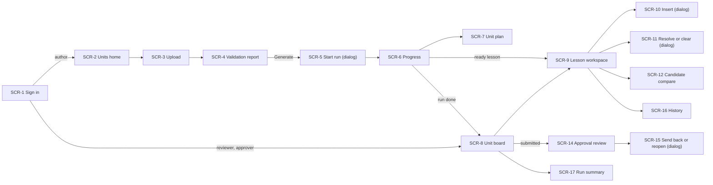
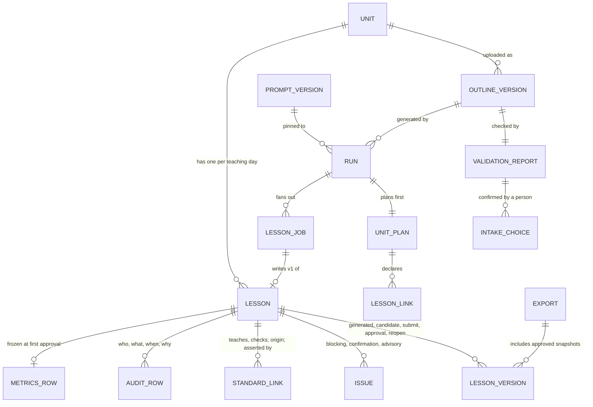

# UX-3b · Information architecture — Newsela Lesson Studio

> **Status:** proposed · **Date:** 2026-10-25 · **Direction:** D1 · Clear Ledger (Innocent ✓ 2026-10-25,
> [`DESIGN-DIRECTIONS.md`](../../design/DESIGN-DIRECTIONS.md)) · **Design doc:** [`design.md`](../../design/design.md)
> **Built from:** [`SITEMAP.md`](../01-planning/SITEMAP.md), [`USER_FLOWS.md`](../01-planning/USER_FLOWS.md),
> [`USER_STORIES.md`](../01-planning/USER_STORIES.md). **Screens:** [`SCREEN_SPECS.md`](SCREEN_SPECS.md).
> Contract ids (`CON-N`) are the draft ids in USER_FLOWS.md; the cards are being written in
> [`docs/contracts/INTERFACE.md`](../../contracts/INTERFACE.md) *(in progress)*. Nothing here is signed.

**What this is.** Where everything lives and how people move between it: the navigation, the things the product is
made of and how they nest, who can see and do what on each screen, and the address of every screen.

**Example.** J. Rivera is a reviewer. She signs in and lands on the Unit 4 board. The board's top row is "Lesson 4:
The Lightning Thief, Chapter 1 · In review · 3 blocking". She clicks it and the address becomes
`/units/g6-u4/lessons/L4`. She clicks issue 1 in the rail; the address gains `?issue=…` so a colleague she sends the
link to lands on the same issue. Later the approver opens `/units/g6-u4/lessons/L5/approve`, and if J. Rivera tries
that address herself she sees the approval page read-only with "Only approvers can approve", because the server
refuses the action, not just the button.

## 1. Navigation model

**Three surfaces behind one sign-in** (SITEMAP): intake and runs (author), review (reviewer), approval and evidence
(approver). They share one app shell (design.md §4): a left nav rail, a top bar with a breadcrumb, and the main area.

### The left nav rail (icons with names as tooltips)

| Icon (look sheet) | Name | Goes to | Shown to |
|---|---|---|---|
| Grid | Units | SCR-2 Units home | everyone |
| Document | Unit board | SCR-8 for the current unit | everyone |
| Upload | Upload outline | SCR-3 for the current unit | author |
| Shield | Approvals | SCR-8 filtered to `submitted` | approver |
| Gear (bottom) | Prompt guidance | SCR-21 (cut #7) | author; hidden when cut |

**Proposal: the rail shows only what the role can do**, to keep it short. This is a convenience, not the control: the
server refuses every action for the wrong role (`ROLE_FORBIDDEN`, every action contract), and a deep link to a page
the role can only read opens read-only with the reason in text (§3).

### Landing after sign-in (FLOW-1)

| Role | Lands on |
|---|---|
| `author` | SCR-2 Units home |
| `reviewer` | SCR-8 Unit board (the MVP has one unit, so it opens Unit 4 directly) |
| `approver` | SCR-8 Unit board |
| any, from a deep link | the linked screen, after sign-in |

### Breadcrumbs

Always *Units › Grade 6 · Unit 4 › <page>*. Lesson pages add the lesson: *Units › Grade 6 · Unit 4 › Lesson 4*. The
approval review adds *Approvals*: *Unit 4 › Approvals › Lesson 5* (look sheet M4). Every crumb but the last is a link.

### Moving between screens (the main paths)

**Rules of movement.**
- **Dialogs have no address** (SCR-5, SCR-10, SCR-11, SCR-15). Reloading closes them. Nothing is written until the
  dialog's confirm button succeeds, so closing one loses only what was typed (proposal UXQ-1 in SCREEN_SPECS.md).
- **Side panels are part of their page** (SCR-13 AI assist lives inside SCR-9).
- **Back always works:** every page has an address, and filters and the selected issue live in the query string.
- **A submitted lesson opens differently by role:** the reviewer gets SCR-9 read-only; the approver's "Open" on the
  board goes to SCR-14.

## 2. Object model (what the product is made of)

**In plain words.** A **unit** (Grade 6 · Unit 4) has numbered **outline versions** (each upload). Each version has
one **validation report** and the author's **intake choices**. A **run** starts from one version with a pinned
**prompt version** and a spend cap; it writes a **unit plan** first, then one **lesson job** per teaching day. Each
job produces a **lesson**. A lesson has **versions**: the generated v1, candidates, and snapshots frozen at submit,
approval and reopen. Around each lesson sit its **issues**, its **standard links**, any **links to other lessons**
and its **audit rows**. An **export** gathers approved snapshots.

| Object | Who creates it | Example | Shown on |
|---|---|---|---|
| Unit | seeded (MVP: one) | Grade 6 · Unit 4 · *The Lightning Thief* | SCR-2 |
| Outline version | author uploads | version 1 · `g6-u4-outline.xlsx` · SHA-256 · 41 lessons, 6 flex days | SCR-2, SCR-3, SCR-4 |
| Validation report + intake choices | product, then author confirms | "5 errors to confirm"; row 39 confirmed as a safety note by A. Chen | SCR-4 |
| Prompt version | author saves guidance | locked layer + guidance v1 | SCR-5, SCR-21 |
| Run | author starts | rows 8, 9, 25 · cap · `running` | SCR-6, SCR-17 |
| Unit plan + lesson links | product, one call | "Lesson 4 Homework → Lesson 5 excerpt slot" | SCR-7, SCR-8, SCR-9 |
| Lesson job (tile) | product | Lesson 22 · `failed` · truncated | SCR-6 |
| Lesson | product (v1), then people | Lesson 4 · Reading · `in_review` · reviewer M. Okafor | SCR-8, SCR-9, SCR-14 |
| Lesson version | product or a person's action | v3 · snapshot `9f3c…a21e` | SCR-12, SCR-14, SCR-16, SCR-20 |
| Issue | product (checks) | "Quote placeholder open · `G6.U4.L4.LearningInAction.PartA`" | SCR-9, SCR-14 |
| Standard link | outline or product; confirmed by a person | `L.6.4.b` · narrowed · confirm | SCR-9, SCR-14, SCR-18 |
| Audit row | every person's action | "Safety flag cleared by J. Rivera: <note> · 10:42" | SCR-16 |
| Metrics row | product at first approval | NS minutes, G-2, rating | SCR-8 (aggregate only), SCR-19 |
| Export version | approver | export v1 · 3 lessons · Lesson 4 held back | SCR-20 |

**Containment rule for addresses:** every lesson-level object hangs under its unit, so every screen address starts
`/units/:unitKey`. Runs also hang under the unit (a run belongs to one outline version of one unit).

## 3. Roles × screens

**Key:** **A** = can act (the screen's actions are theirs) · **R** = can open and read; actions are absent or shown
off with the reason · **—** = not offered in the nav; a deep link opens a role-forbidden state with the reason and a
link back to the board. The server enforces every action (`ROLE_FORBIDDEN`); this table is what the screen shows.

| Screen | Author (P-2) | Reviewer (P-1) | Approver (P-3) | Note |
|---|---|---|---|---|
| SCR-1 Sign in | A | A | A | |
| SCR-2 Units home | A | R | R | SITEMAP: all can open |
| SCR-3 Upload outline | A | — | — | |
| SCR-4 Validation report | A | R | R | Others read it; confirm buttons absent |
| SCR-5 Start run (dialog) | A | — | — | "Only authors can start a run" |
| SCR-6 Generation progress | A | R | R | Cancel, Retry failed, Resume: author only |
| SCR-7 Unit plan | R | R | R | read-only for all |
| SCR-8 Unit board | R | A | A | Author reads; reviewer opens lessons; approver opens submitted ones |
| SCR-9 Lesson workspace | R | A | R (clears a safety flag: A) | Approver may clear a safety flag (SITEMAP SCR-11) |
| SCR-10 Insert quote or excerpt | — | A | — | |
| SCR-11 Resolve or clear | — | A | A (safety-flag clear only) | |
| SCR-12 Candidate compare | A (guidance trial) | A | R | |
| SCR-13 AI assist (cut #8) | — | A | — | |
| SCR-14 Approval review | R | R | A | Reviewer sees it read-only: "Only approvers can approve" |
| SCR-15 Send back or reopen | — | — | A | Reopen is an approver action (UXP-4) |
| SCR-16 History and provenance | R | R | R | |
| SCR-17 Run summary | R | R | R | |
| SCR-18 Coverage (cut #4) | R | R | R | |
| SCR-19 Unit quality (cut #6) | R | R | R | Aggregate only (GR-15) |
| SCR-20 Export (cut #5) | R | R | A | `ROLE_FORBIDDEN` for non-approvers |
| SCR-21 Prompt guidance (cut #7) | A | R | R | |

**Four eyes** (FLOW-12): an approver who was the last editor of a lesson sees SCR-14 with Approve off and the reason
"Someone else must approve: you were the last editor". The role is the same; the rule is per lesson.

## 4. URL scheme (proposal)

Readable keys, so a link pasted in chat says what it opens. `:unitKey` is the grade and unit (`g6-u4`). `:lessonKey`
is the lesson's number from the outline (`L4`, `L35`) or its flex-day key (`F1` … `F6`); `:version` is the outline
version number; `:runId` and `:candidate` are server ids (proposal UXQ-2 in SCREEN_SPECS.md: the System track may
prefer opaque ids for every key).

| Screen | Address | Query parameters |
|---|---|---|
| SCR-1 | `/sign-in` | `next=` the page to return to |
| SCR-2 | `/units` | — |
| SCR-3 | `/units/:unitKey/outlines/new` | — |
| SCR-4 | `/units/:unitKey/outlines/:version` | `level=error|warning|ok` filter; `row=` jump to a row |
| SCR-5 | dialog over SCR-4 (no address) | — |
| SCR-6 | `/units/:unitKey/runs/:runId` | `state=` tile filter |
| SCR-7 | `/units/:unitKey/runs/:runId/plan` | `day=` jump to a teaching day |
| SCR-8 | `/units/:unitKey/board` | `state=draft|in_review|submitted|approved|failed|changes_requested|reopened`; `sort=blocking` (default) |
| SCR-9 | `/units/:unitKey/lessons/:lessonKey` | `issue=` selected issue id; `at=` a section address, e.g. `G6.U4.L4.LearningInAction.PartA`; `tab=issues|standards|outline` |
| SCR-10, SCR-11 | dialogs over SCR-9 (no address) | — |
| SCR-12 | `/units/:unitKey/lessons/:lessonKey/candidates/:candidate` | `section=` |
| SCR-13 | panel inside SCR-9 (no address) | — |
| SCR-14 | `/units/:unitKey/lessons/:lessonKey/approve` | — |
| SCR-15 | dialog over SCR-14 (no address) | — |
| SCR-16 | `/units/:unitKey/lessons/:lessonKey/history` | `version=` |
| SCR-17 | `/units/:unitKey/runs/:runId/summary` | — |
| SCR-18 | `/units/:unitKey/coverage` | `standard=` |
| SCR-19 | `/units/:unitKey/quality` | — |
| SCR-20 | `/units/:unitKey/export` | `export=` a version |
| SCR-21 | `/prompt-guidance` | `version=`; program-wide, not per unit (proposal UXQ-3) |

**Rules.** An address never carries a role, a secret or a person's name. An address to a lesson that does not exist
shows "There is no Lesson 48 in Grade 6 · Unit 4" with a link to the board (no stack trace). Signed-out visitors go to
`/sign-in?next=…` and return to the page after sign-in.

## 5. Content priority per screen

What leads, what follows, what waits until asked. "Phone" = visible without scrolling at 390 px (reading, not editing).

| Screen | Primary | Secondary | On demand | Phone first view |
|---|---|---|---|---|
| SCR-1 | Email field, Sign in | Demo accounts note | — | all |
| SCR-2 | Unit card with the latest run state | Outline versions with hash and date | Prompt guidance link | unit card |
| SCR-3 | Choose file / paste link | Accepted types and limits | Parse error detail | picker |
| SCR-4 | Errors to confirm, Generate (off, with reason) | Warnings with defaults; summary counts | OK rows; every row's original cell | summary + first error |
| SCR-5 | Scope, cap, Start run | Pinned prompt version | Estimated cost basis | scope |
| SCR-6 | Run state, cost vs cap, failed tiles | Tile grid | Failure reasons per tile | run state + cost |
| SCR-7 | One line per teaching day | Lesson links | Hand-forwards | first days |
| SCR-8 | Lessons sorted by blocking issues | Roll-up, north-star tile | Filters, run links | top rows |
| SCR-9 | The lesson text; blocking issues; Submit (off, with reason) | Standards and outline row; presence | History, Regenerate, AI assist | title, state, issue count |
| SCR-10 | What the slot asks for; text, source, rights | 12-word counter | Rights help | all |
| SCR-11 | Reason or note, Confirm | What is being resolved | — | all |
| SCR-12 | Current vs candidate by section; Adopt | Candidate state "not adopted" | Note used | one section at a time |
| SCR-13 | Suggestion, Accept / Reject | My note | Student-work warning | n/a (cut #8) |
| SCR-14 | Checklist with evidence; rating; Approve | Snapshot, dependency banner, four-eyes note | Full lesson text (read-only) | checklist |
| SCR-15 | Reason tag and note | What happens next | — | all |
| SCR-16 | Versions with hashes | Provenance per version | Audit rows | version list |
| SCR-17 | Cost per lesson, failures by reason | Wall time, retries, brakes | Report link | key numbers |
| SCR-18 | Standard × lesson grid | Never-assessed highlight | Who confirmed | scrolls in its box |
| SCR-19 | V, O, H tiles with *n* | Rating counts | Seeded-error report | tiles |
| SCR-20 | Approved snapshots, Create export | Held-back dependants | Earlier exports | list |
| SCR-21 | Guidance versions with diff and reason | Locked layer (read-only) | Try on one lesson | latest version |
